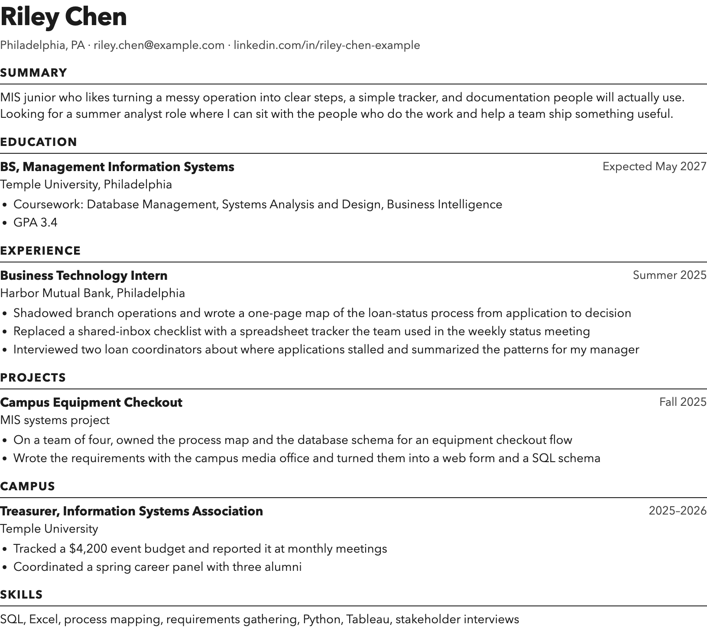
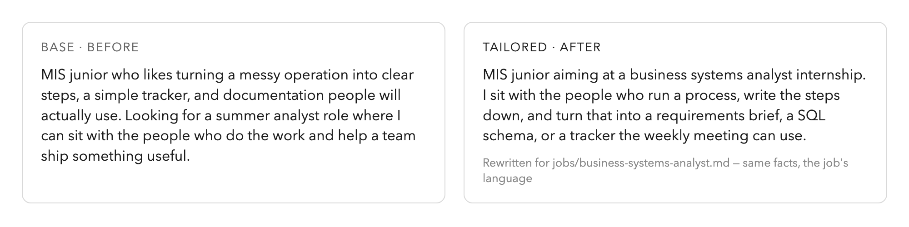
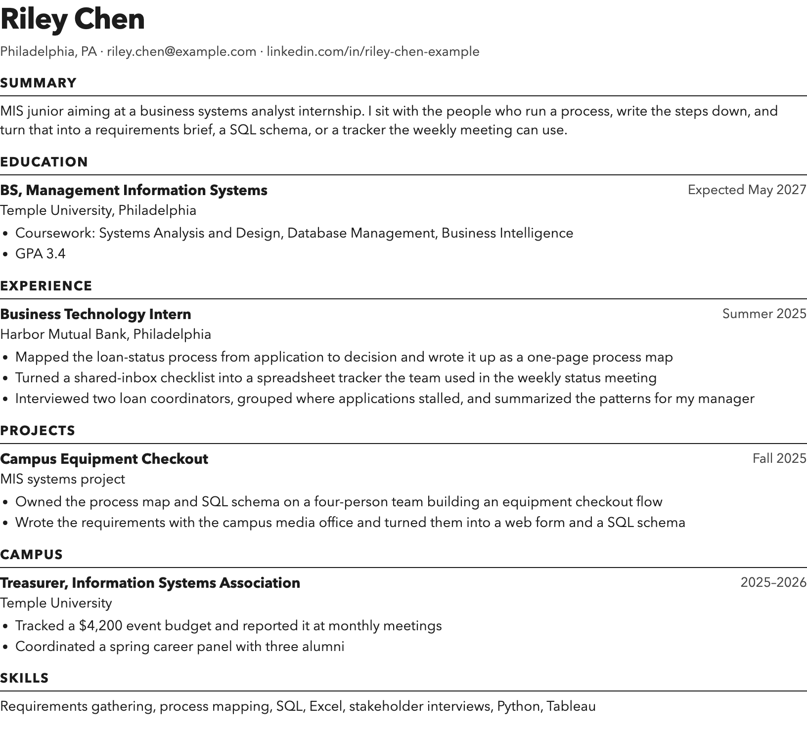
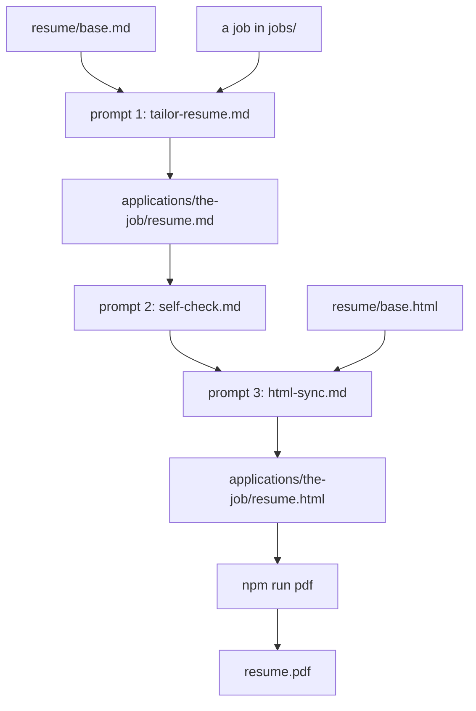

# Resume kit

A one-page resume you can tailor to a job, then export as a PDF. The person in `resume/base.md` is fictional. Replace that file with your own experience before you send anything.

The loop is short:

1. Keep one markdown resume as the source of truth.
2. Ask Cursor to rewrite it for a specific job without inventing experience.
3. Put the same words into the HTML layout.
4. Run a script that prints a PDF.

## 30-minute path

Requirements: [Node.js 18+](https://nodejs.org/) and either Google Chrome or the browser Puppeteer downloads during install.

```bash
git clone https://github.com/luiscielak/resume-kit.git
cd resume-kit
npm install
npm run pdf
```

`npm run pdf` writes `resume/base.pdf` next to `resume/base.html`. Open it. That is the before.



### Tailor it

In Cursor, attach these three files and ask:

- `prompts/tailor-resume.md`
- `resume/base.md`
- `jobs/business-systems-analyst.md`

Paste this:

```text
Read the attached prompt, base resume, and job.
Write applications/business-systems-analyst/resume.md.
Rewrite the summary and three bullets for this job.
Do not add employers, dates, tools, or metrics that are not already in the base resume.
```

You now have a tailored markdown file. The summary is the clearest tell: same facts, the job's language.



There is a second posting in `jobs/product-analyst.md`. Use the same prompt and change the folder name.

### Check it, then build the HTML

Attach `prompts/self-check.md` with `resume/base.md` and your tailored file. It reports anything invented so you can fix it before you trust it.

Then attach `prompts/html-sync.md` with `resume/base.html` and your tailored file:

```text
Follow the attached prompt. Build applications/business-systems-analyst/resume.html from the tailored markdown and keep the base.html layout.
```

### Export the tailored version

```bash
npm run pdf -- applications/business-systems-analyst/resume.html
```

The PDF is written beside that HTML file. Compare it with `examples/business-analyst/`. That folder is one finished tailor of the same base resume for the Northline role. The facts did not change. The summary and the bullets did.



## How this kit is structured

```
resume-kit/
├── resume/
│   ├── base.md      source of truth, replace this with your real experience
│   └── base.html    the layout, same words as the markdown
├── jobs/            drop a job posting here as markdown, one file per job
├── prompts/         the three prompts, explained below
├── applications/    one folder per job you tailor to, your output lands here
├── examples/        a finished tailor to compare your result against
├── scripts/         render-pdf.js turns an HTML file into a PDF
└── slides.html      the workshop deck (open it in a browser)
```

You edit `resume/base.md` and `resume/base.html` once, to make them yours. After that you only add files under `jobs/` and `applications/`. The prompts and the script stay put.

## Which prompt, when

Three prompts, three moments. Attach the prompt plus the files it names, in this order.



1. `prompts/tailor-resume.md` — first. Rewrite `resume/base.md` for a job into `applications/<job>/resume.md`. Attach the prompt, `base.md`, and the job file.
2. `prompts/self-check.md` — second. Catch anything invented before you trust it. Attach the prompt, `base.md`, and your tailored `resume.md`. It reports; you fix.
3. `prompts/html-sync.md` — third. Move the approved words into `applications/<job>/resume.html` for export. Attach the prompt, `base.html`, and your tailored `resume.md`.

Then run the PDF script on the HTML.

## What to check before you trust it

Read the new summary out loud. If it names a tool, a metric, or an employer that was not in `resume/base.md`, delete that sentence. `prompts/self-check.md` is the automated half of this same habit: run it to list what to question, then you make the call. Cursor is drafting. You are the person who signs the resume.

## What this kit leaves out

A later version of this workflow can analyze a job posting, archive each application, and export Word. Start here. Add that layer after you have one resume you can tailor on purpose.
